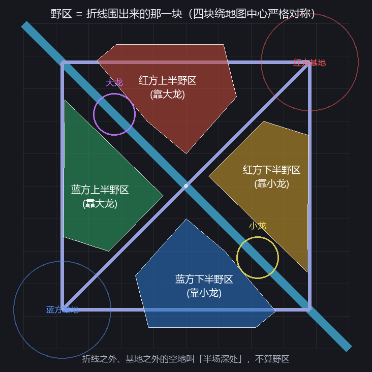

# 反 Gank 哨兵

实时读小地图，认出**是谁**、**在哪**、**还要多久到中路**，在你被 gank 之前出声提醒。

全程只读屏幕像素 + 只读官方本地接口，不注入、不改内存、不模拟输入。

---

## 〇、怎么开始：双击 `启动.bat`

出来一个窗口，五项：**(1) 开始监测　(2) 框选小地图　(3) 勾选要播报的英雄　(4) 分配分路角色　(5) 调整播报优先级**。
鼠标点，或者按 1 / 2 / 3 / 4 / 5。第一次用按顺序 2 → 3 → 4 → 5 → 1 走一遍就行。

| 菜单项 | 做什么 | 什么时候用 |
|---|---|---|
| 框选小地图 | 全屏截图，点小地图左上角 + 右下角两下 | 第一次用、改了分辨率或小地图尺寸 |
| 勾选要播报的英雄 | 卡片界面，只列**本局**敌方那 5 个 | 换阵容后想只听某几个（需在局内） |
| 分配分路角色 | 5 张卡各点一个上/野/中/下/辅 | 想让播报对上真实分路（需在局内，默认已自动填好） |
| 调整播报优先级 | 5 行，点右侧箭头上下挪 | 觉得某条路的消息总被压着，把它挪到上面 |
| 开始监测 | 常驻待机，开局自动接管，一局结束自动等下一局 | 平时就点这个，然后切回游戏 |

命令行等价物：`python main.py menu` / `calibrate` / `pick` / `roles` / `priority` / `run --auto`。
所有窗口都是 OpenCV + Pillow 画的（便携版 Python 没有 tkinter）。

---

## 一、先回答一个前提问题：我怎么知道你的小地图在哪、多大？

**不知道。** 所以所有阈值都写成"占小地图边长的比例"，再靠一次校准把像素矩形定下来。

```bash
python main.py calibrate
```

弹一个半透明遮罩（画面冻结，点得从容），**点两下就完成**：

1. 点小地图**左上角** → 出现十字标记，鼠标周围有聚光灯帮你看清边框
2. 点小地图**右下角** → 绿框落下，`280x280px　icon~20px` 标在旁边，**立即保存并退出**

按 **R** 可重选，**Esc** 取消；什么都不点直接 Enter 则接受橙色**默认猜测框**
（右下角、边长 ≈ 屏高 23%）。结果写进 `config.json`：

```json
"capture": { "region": { "left": 1632, "top": 913, "width": 276, "height": 276 } }
```

用两点而不是拖拽，是因为全屏独占/游戏窗口下拖动有可能收不到鼠标松开事件，
框会卡在半路；两次独立点击没有这个风险，点击落点也比拖拽收手更准。
点得不够方正（`dx ≠ dy`）时，按两点中点居中、取较长边补成正方形——
宁可多含几像素深色底图，也不能裁掉小地图边缘的红点。

两个实现上的坑，记下来免得重踩：

- **不能用 tkinter**。运行时是便携版 Python，没打包 tcl/tk，`import tkinter`
  直接 `ModuleNotFoundError`。改用 OpenCV 全屏窗口 + Pillow 画中文。
- **必须装带 GUI 的 `opencv-python`**，不是 `opencv-python-headless`。后者把
  `imshow` 整个编译掉了，`namedWindow` 会抛 `The function is not implemented`，
  校准窗口和 `--debug` 预览都打不开。
- 窗口要主动置顶抢焦点（`AttachThreadInput` + `SetForegroundWindow`），否则
  第一次点击会被系统拿去"激活窗口"，表现是"点了没反应，得点两下"。


为什么不用固定坐标：小地图大小由游戏内滑块（设置 → 界面 → 小地图）和分辨率共同决定，
同一个人的两台机器就可能差 20%。而检测里所有尺寸都是比例：

| 参数 | 值 | 含义 |
|---|---|---|
| `min_icon_ratio` / `max_icon_ratio` | 0.040 / 0.115 | 英雄头像直径 ÷ 小地图边长 |
| `fill_min` / `fill_max` | 0.20 / 0.85 | 红色像素 ÷ 外接矩形 |

所以 200 px 和 400 px 的小地图用同一套参数。校准只决定"抓哪块"，不决定"怎么判"。

校准后会立刻抓一张、跑一次检测、把结果存成 `assets/calib_preview.png`，
并打印 `按预期英雄头像直径约 N px` 和检出数量，作为"框对了没有"的验证。

程序启动时调 `SetProcessDpiAwareness(2)`，直接用物理像素，125%/150% 缩放下不会错位。

## 二、三层信息，各走各的路

```
位置  ←  小地图红色描边检测（纯 CV，1.5 ms）
身份  ←  官方 Live Client Data API（敌方 5 人名单）+ 头像模板匹配
区域  ←  几何换算（分路 / 河道 / 龙坑 / 四个野区块）
```

**身份不该靠像素猜。** Riot 随客户端启动一个只读本地接口：

```
https://127.0.0.1:2999/liveclientdata/allgamedata
```

它给出双方英雄名、等级、装备、游戏时间 —— 但**不给任何人的坐标**。
所以：身份从 API 读，位置从像素看，两者用 Data Dragon 头像模板对上号。

有小地图就有 5 个红点，有 API 就有 5 个名字，把红点头像和头像库做归一化互相关，
取最高分且**一帧内每个英雄只用一次**（贪心指派，消歧）。

**国服接口给的是中文名**：`championName` 返回 `"齐天大圣"`、`"异画师"`，而模板库、
语音文件、勾选名单统统用 Data Dragon 的英文 key（`MonkeyKing`、`Hwei`）。
`ChampionBook.resolve()` 用"本名 / 称号 / key"三张反查表归一化（173 个英雄全量验证过，
零冲突）——不做这一步，候选列表里一个都匹配不上，程序会安静地一句都不报。

- 单帧 top-1 准确率：**91.3%**（173 个英雄里 5 选 1，实测见 `python tools/idbench.py`）
- 每条轨迹对最近十几帧投票，1 秒内收敛，稳定性远高于单帧数字
- API 没连上时退回全英雄匹配，只是慢一点、偶尔认错，报警照常

模板遮罩半径是个关键参数：0.34 时 91%，调到 0.46 掉到 66.7%。
因为小地图头像是"方形原画裁圆 + 外圈红描边"，描边不携带身份信息，还会把所有英雄
的相关度一起拉向红区。`idbench.py` 就是用来扫这个参数的。

## 三、地图分区：分路 / 河道 / 野区

归一化坐标 `nx, ny ∈ [0,1]`，原点小地图左上角，y 向下：

| 判定 | 依据 | 为什么这么定 |
|---|---|---|
| 蓝方基地 / 红方基地 | (0.12,0.88) / (0.88,0.12) 半径 0.15 | 小地图上一整块平台，不是一个点 |
| 中路 | 折线 (0.12,0.88) → (0.88,0.12) | 两个基地正好在这条线两端 |
| 上路 | 折线 (0.12,0.88) → (0.12,0.12) → (0.88,0.12) | 沿左边上去，再沿上边过去 |
| 下路 | 折线 (0.12,0.88) → (0.88,0.88) → (0.88,0.12) | 沿下边过去，再沿右边上去 |
| 分路带宽 | 到中心线垂距 ≤ 0.062 | 塔就修在分路上，站在塔边就是"在分路" |
| 河道 | 到副对角线 `nx = ny` 垂距 < 0.045 | 大龙坑和小龙坑都在这条线上 |
| 大龙坑（先锋） | 到 (0.28,0.28) 距离 < 0.065 | 先锋和大龙共用一个坑 |
| 小龙坑 | 到 (0.72,0.72) 距离 < 0.065 | |
| 四个野区块 | **折线围出来的那一块**（见 `geo.BLUE_JUNGLE`），不是"除去分路剩下的全部" | 见下面的说明 |
| 半场深处 | 野区折线外、基地外的空地（二塔后面、高地墙内） | 播报说"半场深处"，不叫野区 |

**为什么分路要用"到折线的距离"**：上路是 L 形折线，不是"离地图边近"。早期版本用
`min(nx,ny) < 0.11` 这种写法，结果**贴着右边墙的下路二塔附近被算成上路/野区**——
实测你那张小地图里，冰鸟站在 (0.862, 0.293) 的右边缘红塔旁，却被报成"红方下路野区"。
现在三条分路各自量垂距取最近的一条，塔的位置全部落在分路上（红方上路二塔在
(0.68,0.17)、蓝方下路塔在 (0.35,0.86) 和 (0.62,0.89)，都验证过）。

**野区是折线围出来的那一块，不是"剩下的都算"。** 早期写法是"不在分路、不在河道，
那就是野区"，结果二塔后面、高地墙外那圈空地全被算成野区——敌人站在塔后等兵线，
也会报"出现在野区"。现在每块野区是一个多边形，用射线法判定：

```
      上路 ─────────┬────────────────
                    │                 │
                    │   野   区        │   ← 里侧是二塔连线，不是基地
      二塔连线 ─────┴─ 中路 ─────────→ 河道
```

只写蓝方半场的两块（`BLUE_JUNGLE`），红方两块由**绕地图中心转 180°** 生成
（`_flip180`）。地图本身中心对称，这样两边形状永远一致，不会一边胖一边瘦。
转 180° 会把"靠大龙侧"换成"靠小龙侧"（大龙左上、小龙右下），所以
`jg_red_top` 取的是 `jg_blue_bot` 翻过来的那块——**不是抄错**。

折线之外、基地之外的空地叫**半场深处**（`deep_blue` / `deep_red`）。它不算野区，
但敌人摸到那儿还是要说一声，说法换成"出现在我方半场深处"，不会说成"野区"。



（图由 `python tools/show_zones.py` 生成，改了 `BLUE_JUNGLE` 之后跑一次对眼睛。）

**上半野区 / 下半野区到底怎么分**：判据只有一个 —— **靠大龙那侧叫上半，靠小龙那侧叫下半**。
沿中路看，`nx + ny < 1` 那一半在大龙这头，`> 1` 那半在小龙那头。这对蓝红双方都自动成立，
不用管我方在地图上半边还是下半边：

| 区域 | 位置 | 在蓝方眼里 | 在红方眼里 |
|---|---|---|---|
| `jg_blue_top` | 左侧中部（靠大龙） | 我方上半野区 | 敌方上半野区 |
| `jg_blue_bot` | 底部（靠小龙） | 我方下半野区 | 敌方下半野区 |
| `jg_red_top` | 顶部中间（靠大龙） | 敌方上半野区 | 我方上半野区 |
| `jg_red_bot` | 右侧中部（靠小龙） | 敌方下半野区 | 我方下半野区 |
| `deep_blue` / `deep_red` | 二塔后面、高地墙外 | 我方 / 敌方半场深处 | 敌方 / 我方半场深处 |

> 网上有些示意图把蓝方画在上半边，那是把地图转了 180° 的图。**真实小地图里蓝方基地
> 固定在左下、红方在右上**，所以 `python main.py run` 启动时会打印一行
> `阵营：我方 蓝方（位于地图下侧）· 敌方 红方（位于上侧）`，对一眼就知道判断对不对。

**分路本身不播"我还在路上"**：只在**进出那一刻**才开口（见下一章）。敌人一直在线上
补刀，报了只是噪音；只有状态翻转才值得说一句。

拿到对局信息后，蓝/红会自动改口成**我方/敌方**（`zone_label(key, my_side)`）。

## 四、按分路角色的行为播报

先把本局 5 个敌人各分一个角色，再按角色定义"什么算值得说的事"。

| 角色 | 盯什么 | 播报 |
|---|---|---|
| 上路 | 上路的进出 | 敌方暗裔剑魔从上路消失<br>敌方暗裔剑魔出现在上路 |
| 下路 | 下路的进出 | 敌方暴走萝莉从下路消失 |
| 辅助 | 下路的进出 + 野区河道 | 上面两条，加上野区那套 |
| 打野 | 野区、河道、龙坑 | 敌方盲僧出现在敌方上半野区 |
| 中路 | 连续 10 秒不见人 | 敌方九尾妖狐消失 |

**全是边沿，不是状态。** 一个敌人在上路补了五分钟刀，就不该每帧喊一次"在上路"，
只有"在路 → 不在路"的那一次翻转才播。两个方向都要求状态**持续**一段时间：
离开要满 3 秒、回来要满 2 秒，贴着分路边线来回蹭不会触发。

**状态挂在英雄身上，不挂在轨迹上。** 轨迹会因为"走进迷雾 → 4 秒后被回收"而消失，
可"中路已经 10 秒没露头"恰恰要求轨迹已经没了还能继续算。所以每个英雄各存一份
状态，轨迹只负责往里喂"最后可见时间 + 当前区域"。

### 每 2 秒一批，一批最多一条

1 Hz 采样下，5 个敌人各自进出视野，一秒内能同时冒出三四条信息。逐条喊的结果就是
几句叠在一起，谁也听不清。所以改成固定节拍，**每 2 秒最多说一句**：

```
0s      2s      4s      6s
 |─收集─|─收集─|─收集─|─收集─|
        1 条    0 条    1 条
```

- 一句最长 1.95 秒，塞进 2 秒的格子里，永远不会串台。
- **这一批没轮上的留到下一批**（最多留 6 秒）。5 个人同时有动静时，后面那几条不该被
  扔掉，多说两批总能说完；但超过 6 秒就过时了，不再念。
- 同一英雄一次只占一个名额 —— 两句都念同一个名字是浪费。

**先播谁，按"分路优先级"排**（菜单第 5 项可以改，默认 中 > 野 > 辅 > 下 > 上）：

```bash
python main.py priority      # 或菜单第 5 项
```

5 行，右边一对上下箭头，点一下换位置，Enter 保存。同一角色的多条再按"有多具体"排：
**我方半区野区 > 敌方半区野区/河道/龙坑 > 从分路消失 > 回到分路 > 中路消失**。

### 单条语音压在 2 秒内

原来的做法是"英雄名 wav + 动作短语 wav"拼接，实测最坏组合
`敌方德玛西亚皇子`(1.19s) + `出现在敌方上半野区`(1.58s) = **2.77 秒**，超了 38%。
拼段还有几十毫秒的段间静音，连播两条时听起来像卡顿。

现在改成**整句合成**：文本直接是"敌方德玛西亚皇子出现在敌方上半野区"，合成后量一下
时长，超过 1.95 秒就按比例提高语速重合成一次。实测 173 个英雄里最长的一位也只要
1.84 秒。第一次播到某句会现合成（约 0.35 秒），之后读缓存；开局还会在后台把这一局
可能说到的二十来句先批量合成好。

### 角色怎么分配

```bash
python main.py roles      # 或菜单第 4 项
```

5 张卡，每张下面是 上 / 野 / 中 / 下 / 辅 五个按钮，点一下就换。两个人抢同一个角色
= 互换位置，永远是 5 个角色各一人。

默认值不是空白的：`Live Client API` 的 `position` 字段在排位/匹配里会给
`TOP / JUNGLE / MIDDLE / BOTTOM / UTILITY`，直接拿来用；人机模式那里是空字符串，
就按 上→野→中→下→辅 的顺序补齐 —— 所以窗口打开时通常已经填好了，只需核对。

保存结果写进 `config.json`：

```json
"roles": { "assign": { "Aatrox": "top", "LeeSin": "jungle", "Ahri": "mid",
                       "Jinx": "adc", "Thresh": "support" } }
```

### 播报优先级怎么排

```bash
python main.py priority      # 或菜单第 5 项
```

每 2 秒只说一句，所以"同时有三条要说"时必须有个先后。窗口里 5 行，靠上的先播，
点右侧上下箭头挪位置，Enter 保存：

```json
"behaviour": { "priority": ["mid", "jungle", "support", "adc", "top"] }
```

默认中路第一 —— 你多半站在中路，中路的消息最能救命；上路离你最远，排最后。
改了不影响其他任何设置，想改回来按默认顺序重排一遍即可。

### 名字是怎么保证念得出来的

1 Hz 下单帧头像识别准确率只有 70~90%，等"两票确认"就是 2 秒空窗，于是旧版
经常只播位置、把名字念成"敌人"。现在按三级阶梯取名字，几乎不会落到无名兜底：

| 阶梯 | 依据 | 什么时候用得上 |
|---|---|---|
| 确认身份 | 单帧相关度 ≥ 0.86，或 2 票 + 45% 占比 | 露头 1~2 秒后 |
| 排除法 | 敌方 5 人已知，场上 4 条轨迹已认出来 → 第 5 条只能是剩下的那个 | 票数永远差一票的脸盲英雄 |
| 累计分 | 每帧所有候选的相关度都按分值累加，取长期最高 | 第一次露头的第 0.5 秒 |

猜出来的名字在控制台标 `（推测）`，语音不区分——听到名字比听到"敌人"有用。

**念的是称号不是本名**：`大发明家`（黑默丁格）、`冰晶凤凰`（艾尼维亚）、`盲僧`（李青）。
称号就写在客户端头像下面，听到反应最快。个别称号不好念的可以在
`assets/champions/spoken.json` 里覆盖：`{"LeeSin": "盲僧"}`。

### 只播报你关心的英雄

```bash
python main.py pick
```

开局后跑一次，弹出一个只列**本局敌方 5 个英雄**的勾选面板（名单来自本地对局接口，
不是猜的）。点一下卡片切换，`A` 全选、`N` 全不选、`Enter` 保存、`Esc` 取消。
不在局内时直接提示，不会列全 173 个英雄。

结果写进 `config.json` 的 `champions.notify`：

```json
"champions": { "notify": ["LeeSin", "Yasuo"] }   // 空列表 = 全部播报
```

两个细节是为"不误事"设计的：

- **名单非空时，身份还没认出来的红点一律静音**。否则勾了"只想听李青"，却还是会被
  别的红点吵到。代价是识别收敛前（约 1 秒）会有延迟。
- **名单和本局阵容完全无交集时，本局自动放开为全部播报**并打印警告。换英雄后忘了
  重选，不至于整局一声不响——静音是最糟的失败方式。


## 五、实测性能

在同一台机器上跑的（1920×1200，GDI 采集）：

| 阶段 | 实测 | 备注 |
|---|---|---|
| BitBlt 抓 280×280 | **16.5 ms** | 与区域大小无关（100² 和 800² 一样），是固定开销 |
| GetDIBits 读回 | 0.09 ms | 可以忽略 |
| 红色环检测 | **1.46 ms**（p50） | 首帧 19 ms 是 OpenCV 线程池预热，稳态无关 |
| 跟踪 + 判定 | <0.3 ms | |
| 头像识别（5 候选） | ~0.1 ms | |
| 播报 | <5 ms | 异步，不阻塞主循环 |

**关于那个 16.5 ms**：裸 ctypes BitBlt 同样是 16.57 ms，所以不是 mss 的开销，是这台机器
上 BitBlt 本身慢 —— 机器上装着向日葵 `OrayIddDriver` 和 `MuMu Virtual Display Adapter`
两个虚拟显示适配器，桌面很可能是软件合成。普通独立显卡本地桌面抓 280² 一般 0.3–1 ms。

对策（按顺序试）：

1. 把分析频率降到 1 Hz（`capture.fps`，默认已经是了），16.5 ms × 1 ≈ 1.7% 单核
2. 换 DXGI 后端：`pip install dxcam`（Python 3.13 可能要 `bettercam`），
   然后 `capture.backend = "dxgi"` —— 走 GPU 侧复制，绕开 CPU BitBlt
3. 关掉向日葵 / MuMu 再试

资源占用不受影响：内存 200–280 MB，显存 <1 MB（GDI 完全不碰显存；DXGI 只多一张
280×280 的 staging texture，约 0.3 MB）。对比 LoL 本体 1.5–3 GB 显存。

## 六、安装与使用

```bash
pip install numpy opencv-python mss Pillow   # 必需（opencv 必须带 GUI，不能是 headless）
pip install pyttsx3 comtypes                 # 可选，生成语音用

python tools/fetch_champions.py              # 173 个英雄头像 + 中文名，约 5 MB
python tools/make_voice.py --champs           # 198 条语音，约 7 MB
python main.py calibrate                     # 可选：点两个角校准（不跑也能用右下角默认框）
python main.py doctor                        # 自检
python main.py pick                          # 局内：勾选要播报的敌方英雄
python main.py roles                         # 局内：分配 5 个敌人的分路角色
python main.py run --auto                    # 常驻：开局自动接管，一局结束自动等下一局
python main.py run --debug                   # 带预览窗口
python main.py run                           # 正式跑
```

**双击没反应？看 `antigank.log`。** 每次运行都会把全部输出同时写进这个文件，
窗口一闪而过也能查到原因。

**最省事的用法：双击 `启动.bat`**，它跑的就是 `run --auto` —— 开着不管，
进游戏自动开始监测，打完自动回到待机等下一局。不开局时只做 HTTP 探测，
不抓图不做 CV，几乎不占 CPU。

`pick`（勾选只播报哪些英雄）每局阵容不同要重勾；`roles` 一般不用管 ——
对局接口会给 `position`，人机模式按 上→野→中→下→辅 自动补。

如果不装 pyttsx3，短语会退化成提示音（不同告警用不同音高节奏），但英雄名就没有了。

## 七、不开游戏也能验证的测试

```bash
python tools/test_real.py   # 真实截图基准：2/2 英雄检出、3/3 红方塔排除（最关键的一个）
python tools/test_auto.py   # 自动模式状态机：加载界面不误判、断连正确收尾
python main.py selftest     # 合成小地图：召回 100%、准确 100%、1.55 ms/帧
python tools/idbench.py     # 身份识别参数扫描：173 英雄 × 5 选 1，单帧 91.3%
python tools/test_zone.py   # 区域划分：实测地标 → 分路/河道/龙坑/野区 51 条（含中心对称、野区面积上限）
python tools/show_zones.py  # 画一张 assets/zones_map.png，肉眼核对四块野区的形状和对称性
python tools/test_behaviour.py  # 行为边沿 + 批播 + 角色分配 + 语音时长，8 个用例
python tools/test_voice.py      # 语音能不能真的出声：缓存 / 3 线程并发 / 连做 6 次 / 时长
python main.py e2e          # 全链路：从上路消失 / 出现在河道 / 野区露头 / 中路消失
python tools/test_name.py   # 播报一定带英雄名：已识别 / 延迟解析 / 排除法 / 累计分 / 重生继承
```

三个界面也做了自动化验证（模拟鼠标/键盘，不需要人点）。它们跑在
`assets/.test_config.json` 上，**不会动你真正的 `config.json`**，小地图校准不会丢：

```bash
python tools/test_calib.py  # 模拟点两个角，校验写进 config 的矩形分毫不差
python tools/test_pick.py   # 模拟点掉两张卡 + Enter，校验 notify 名单
python tools/test_roles.py  # 模拟点角色按钮，校验"互换"后仍是 5 个角色各一人
```

`pick` / `roles` 不在局内时都可以加 `--demo` 预览固定阵容的界面。

`selftest` 里放的干扰项是红方建筑（实心方块 + 实心菱形），两者都该被过滤掉 —— 100% 召回
且零误报，说明尺寸、填充率、内圆红色占比三层过滤是有效的。

## 八、参数调优

改 `config.json`，重启生效：

| 键 | 默认 | 什么时候改 |
|---|---|---|
| `detect.fill_min/max` | 0.20 / 0.85 | 误检多就收窄到 0.30 / 0.60 |
| `detect.inner_red_max` | 0.80 | 红色系英雄被漏检时调高 |
| `behaviour.period` | 2.0 | 每批间隔；调小会开始挤，调大更迟钝 |
| `behaviour.max_items` | 1 | 一批最多几条；1 条配 2 秒刚好不串台 |
| `behaviour.priority` | 中>野>辅>下>上 | 多条待播时的先后；用 `main.py priority` 改最方便 |
| `behaviour.line_max` | 1.95 | 单条语音上限；调大能容忍更长的话，但两条会超过 4 秒 |
| `behaviour.warmup` | 30.0 | 开局静默多久（只建立"谁本来在哪"的基线） |
| `behaviour.leave_hold` | 3.0 | 离开分路要持续几秒才算真离开，太小会在边线抖 |
| `behaviour.enter_hold` | 2.0 | 回到分路同理 |
| `behaviour.mid_vanish` | 10.0 | 中路多久没露头算"消失"（方案里写的是 10 秒） |
| `behaviour.cd` | 25.0 | 同一英雄同一动作的冷却 |
| `roles.assign` | `{}` | 用 `main.py roles` 设置；手改也行，值取 `top/jungle/mid/adc/support` |
| `capture.fps` | 1 | 每秒检测一次。1 Hz 下敌人最多移动 7px（头像直径 21px），足够跟踪 |
| `champions.notify` | `[]` | 用 `main.py pick` 设置；手改也行，填英雄英文 key |

## 九、没声音怎么查

先跑这个，它会现场合成三句并逐句播出来：

```bash
python main.py saytest
```

输出分三种情况，对应三个不同的问题：

| 现象 | 说明 | 怎么办 |
|---|---|---|
| `✗ 合成失败` | TTS 引擎本身坏了 | 检查 Windows 中文语音包（设置 → 时间和语言 → 语音） |
| `✓` 都合成成功，但没有声音，也没报错 | 系统那边静音了 | 音量合成器看 `python.exe`、输出设备选对、游戏关掉「全屏独占」 |
| `有 N 次播放报错` | 音频设备被独占 | 游戏改无边框窗口，或声音设置里关掉独占模式 |

### 这里踩过两个坑，都很难查

**一、`eng.stop()` 会毒死引擎。** pyttsx3 合成完如果调 `eng.stop()`，下一次
`pyttsx3.init()` 就永远不返回。表现是日志里 `[voice] 已生成语音` 打印到第 3、4 条
就没了，之后整场一句不响。现在合成完只做 `del eng` + `gc.collect()`，绝不调 stop。

**二、一个进程只认第一个用 SAPI 的线程。** 后台补英雄名的线程和播报线程同时合成时，
后启动的那个线程**不报错**，只是每句都返回失败、文件根本不生成 —— 于是播放线程
整场哑着，控制台却一直在打「播报 敌方XXX出现在河道」。现在整个进程只有一个合成
线程（`Voice._syn_worker`），谁要合成都排队，`_prebuild_names` 也改成走 `vc.prepare`
排队。播放失败也不再被 `except: pass` 吞掉，会写进日志。

这两条都有回归用例守着：`python tools/test_voice.py`（5 个用例，含 3 线程并发合成）。

## 十、已知限制

- 两个英雄图标重叠时会合成一个大框，被尺寸过滤掉 → 那一下会漏一个人。
- 单帧身份识别 91%，遇到两个头像风格相近的（同类皮肤系列）可能短暂认错，投票会纠正。
- 敌方英雄在扫描/被标记时头像短暂变黄，可能丢一两帧，12 Hz 下无感。
- 区域划分按"塔就在分路上"这一实测规律拟合，不是拳头官方的区域数据；
  分路带宽 0.062 是按真机地标（塔离中心线 0.02~0.05、野区英雄 ≥0.13）定的；
  遇到自定义 UI 或非标准地图（比如极地大乱斗）就别用了 —— 分路角色那一套只对上峡谷有意义。
- 只支持召唤师峡谷。

## 十一、合规

只读屏幕、只读官方本地接口、本地推理，不读写游戏内存、不注入 DLL、不模拟键鼠。
Blitz / Porofessor 走的也是这个 Live Client Data API。但 Vanguard 会扫描进程，
**风险自负**。不要拿这套思路做自动补刀、自动走位 —— 那类会直接封号。

## 文件结构

```
antigank/
  capture.py     采集（GDI / DXGI 可切换，自动降级）
  detect.py      红色环检测（尺寸 + 填充率 + 内圆三层过滤）
  champions.py   Data Dragon 头像模板 + 归一化互相关 + 唯一性指派
  live.py        官方 Live Client Data API 轮询
  geo.py         坐标换算、中路/河道/野区几何划分
  tracker.py     多目标跟踪、速度、身份投票
  roles.py       敌方 5 人的分路角色（自动推断 + 手动覆盖 + 互换）
  behaviour.py   按角色的行为边沿（离开/出现在分路、野区河道、中路消失）
  batch.py       2 秒一批、最多一条的播报调度（按分路优先级排队）
  threat.py      旧版威胁判定（已不接线，留作参考）
  voice.py       整句合成（单合成线程）+ 时长卡控 + wav 播放队列
  calibrate.py   两点校准（左上角 + 右下角，含默认猜测框，截屏前留 3 秒切回游戏）
  picker.py      勾选播报哪些敌方英雄（只列本局阵容）
  roles_ui.py    分配分路角色的窗口（5 卡 × 5 个角色按钮）
  priority_ui.py 调整播报优先级的窗口（5 行 + 上下箭头）
  menu.py        双击 启动.bat 看到的四项菜单
  textdraw.py    Pillow 中文文字（cv2.putText 画不了中文）
main.py          run / calibrate / doctor / selftest / e2e
tools/
  fetch_champions.py  拉头像和中文名
  make_voice.py       生成 198 条语音
  sim.py              合成小地图（真实头像渲染）
  test_real.py        真实小地图基准（assets/fixtures/minimap_real.png）
  test_behaviour.py   行为边沿 + 批播 + 角色分配 + 语音时长（8 个用例）
  test_voice.py       语音链路：缓存命中 / 多线程并发合成 / 引擎寿命（5 个用例）
  test_auto.py        自动模式状态机
  test_calib.py       自动验证两点校准
  test_pick.py        自动验证勾选界面
  idbench.py          身份识别参数扫描
  e2e.py              全链路测试
```
